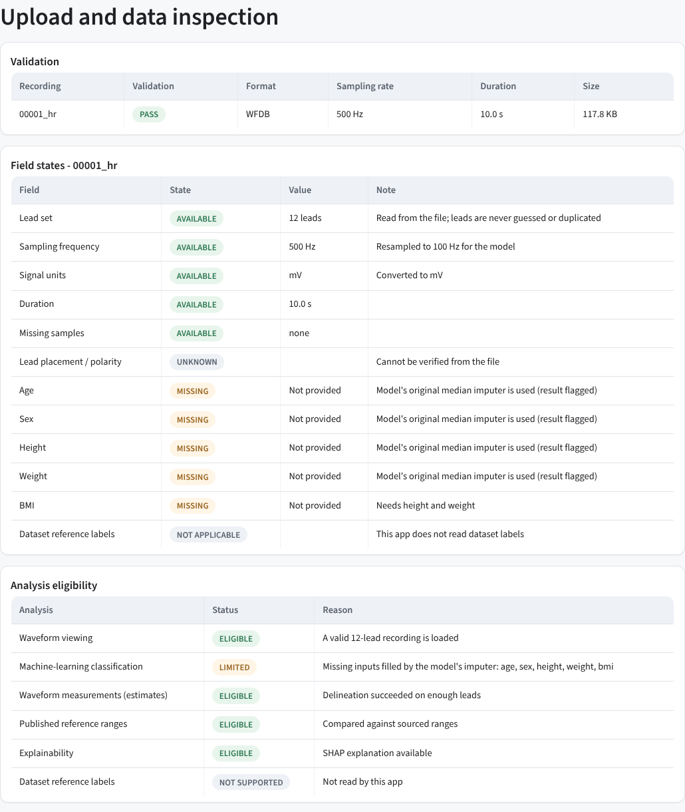
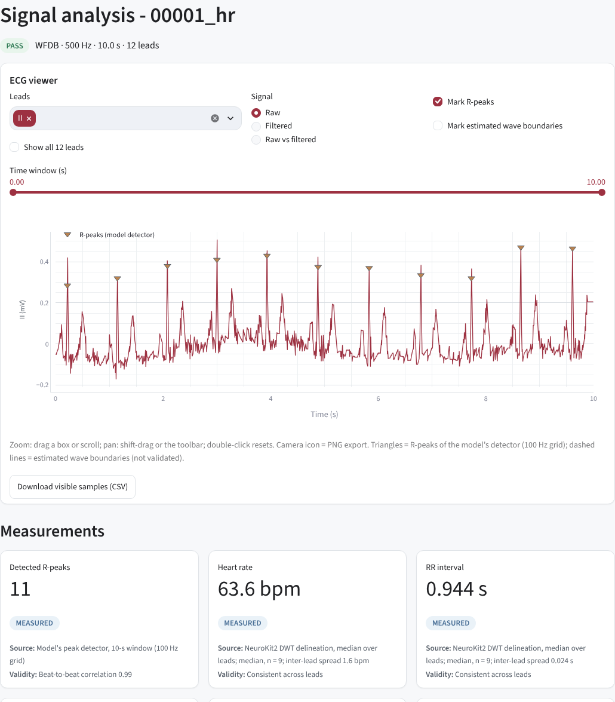
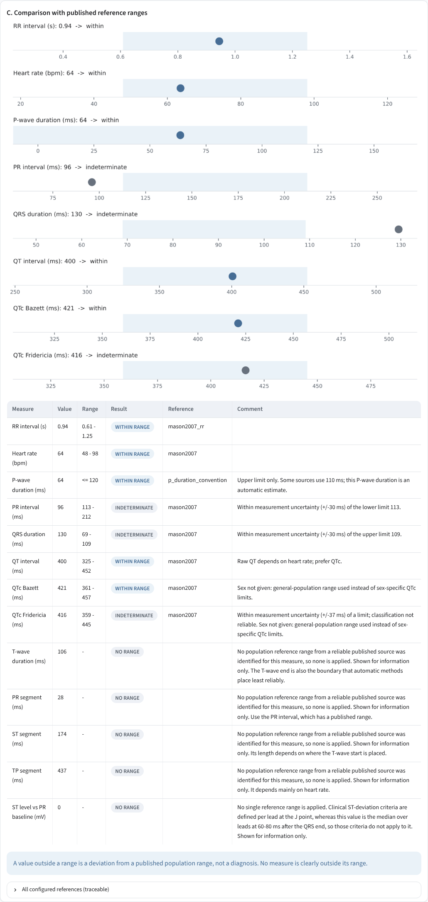

# ECG Insight: PTB-XL Normal vs Abnormal ECG Classification and Web App

An interactive biomedical web app (Streamlit) built on top of a machine-learning model that classifies 12-lead ECGs from the
[PTB-XL dataset](https://physionet.org/content/ptb-xl/) as **Normal** or **Abnormal**.

The project has two parts:

1. **Model (notebook):** from raw waveforms to a tuned Gradient Boosting classifier, evaluated with patient-grouped cross-validation and a held-out test fold.
2. **Web app (this repository):** upload an ECG, inspect the data, view the signal, and get three *independent* analyses: waveform measurements, the model's prediction, and a comparison with published reference ranges.

> **Research prototype, not a medical device.** Nothing in this app is a diagnosis. It has not been validated for clinical use.

---

## Features

- **Upload** WFDB (`.hea` + `.dat`), CSV, TXT or EDF recordings.
- **Data inspection before analysis:** format, sampling rate, units, leads and missing fields are checked and reported (validation `PASS` / `NEEDS REVIEW` / `FAIL`).
- **Interactive ECG viewer** (Plotly): lead selection, all 12 leads, raw or filtered view, R-peaks, estimated wave boundaries, time window, zoom and pan, PNG and CSV export.
- **Three independent analyses, never merged into one conclusion:**
  - **A. Signal measurements:** heart rate, RR, P, PR, QRS, QT and T timings, QTc, ST level.
  - **B. Model prediction:** Normal or Abnormal, with a probability and an explanation.
  - **C. Reference ranges:** measured values compared with published population ranges, with the source of every range.
- **Evidence tags on every value:** `MEASURED`, `ESTIMATED`, `DERIVED`, `PREDICTED` or `UNAVAILABLE`.
- **Downloadable HTML report** with sources and limitations.
- A clean "Clinical Burgundy and White" interface with a top navigation: Overview, Upload, Signal Analysis, Assessment, Reports.

## Screenshots

| Upload and data inspection | Signal analysis |
|---|---|
|  |  |



*Screenshots use an example PTB-XL record (`00001_hr`).*

---

## The model

| Item | Value |
|---|---|
| Dataset | PTB-XL, 21,738 records used |
| Task | Binary: Normal vs Abnormal (label derived from `scp_codes`) |
| Features | 145 per record: 140 waveform features (filtering, R-peaks, HRV, median-beat shape, per-lead statistics) plus 5 demographics |
| Compared models | 7 basic models, patient-grouped 5-fold cross-validation |
| Final model | `HistGradientBoostingClassifier` (learning rate 0.1, max leaf nodes 31), decision threshold 0.5 |
| Preprocessing | Median imputation and standard scaling, fitted inside each training fold |
| Sampling rate | 100 Hz |

**Result on the unseen test fold (fold 10):**

| Metric | Value |
|---|---|
| Accuracy | 0.8531 |
| Balanced accuracy | 0.8611 |
| Precision | 0.9257 |
| Sensitivity (recall) | 0.8171 |
| Specificity | 0.9051 |
| F1 | 0.8680 |
| ROC-AUC | 0.9297 |

At the 0.5 threshold, about 18% of abnormal ECGs are missed. The app loads the exported model as it is: **the model is never retrained and its recorded metrics are never changed.**

---

## Quick start

### 1. Requirements

- Python 3.13 (the combination below was tested with it).
- The exported model files `models/ptbxl_binary_model.joblib` and `models/model_metadata.json`.

> **Important:** the model file is a pickle. It must be loaded with the same numpy and scikit-learn versions it was exported with
> (see `models/model_metadata.json`). Otherwise loading fails with an error such as
> `numpy.random._pcg64.PCG64 is not a known BitGenerator`.

Tested versions: numpy 2.4.6, scikit-learn 1.6.1, scipy 1.16.3, pandas 2.2.3, joblib 1.6.0, wfdb 5.0.0, matplotlib 3.10.0, streamlit 1.67.0.

### 2. Install

**Windows (PowerShell):**

```powershell
cd path\to\ptbxl_cad_app
python -m venv .venv
& .\.venv\Scripts\python.exe -m pip install -r requirements-tested.txt
& .\.venv\Scripts\python.exe -m pip install plotly
```

If PowerShell blocks `Activate.ps1`, you do not need to activate the environment: call `.\.venv\Scripts\python.exe` directly as shown.

**macOS / Linux:**

```bash
cd ptbxl_cad_app
python3 -m venv .venv
.venv/bin/python -m pip install -r requirements-tested.txt
.venv/bin/python -m pip install plotly
```

`requirements.txt` lists the minimum versions used during development. For loading the model, use `requirements-tested.txt` (exact versions
of the tested environment). Do not copy a `.venv` folder between locations: a virtual environment stores absolute paths, so create a new one.

### 3. Run

```powershell
& .\.venv\Scripts\python.exe -m streamlit run app.py
```

(macOS / Linux: `.venv/bin/python -m streamlit run app.py`.) The app opens in your browser. If the real model is missing, the app shows a red banner and uses a synthetic **test stub** whose predictions are meaningless.

### 4. Use it

1. In the sidebar, upload a 12-lead ECG (for WFDB, select both the `.hea` and `.dat` files).
2. If a CSV or TXT file has no sampling rate or units, open **File options (advanced)** and fill them in.
3. Optionally open **Patient information** (age, sex, height, weight). Leave a field empty if unknown; the model's original imputer handles it and the result is flagged.
4. Open the **Upload** page and check the validation result.
5. Press **Analyze Recording**.
6. Review **Signal Analysis**, then **Assessment**.
7. Open **Reports**, press **Generate report**, then download the HTML report.

Example records are in `examples/`.

---

## Input rules

- All **12 standard leads** are required. Lead identity is read from the file and is never guessed, duplicated or invented.
- Sampling rate **100 Hz or more** is resampled to 100 Hz (the model's training rate). Files **below 100 Hz fail** validation, because up-sampling would invent signal content.
- **10 s** are analyzed (at least 5 s are required).
- Units mV, uV or V are converted to mV.
- Unreliable signals give an `indeterminate` result or an error, never a class.

## Reference ranges and sources

| Measure | Range | Source |
|---|---|---|
| Heart rate | 48 - 98 bpm | Mason et al. 2007 |
| RR interval | 0.61 - 1.25 s | Mason 2007 heart-rate range converted (RR = 60 / HR) |
| P-wave duration | up to 120 ms | Conventional adult upper limit (some sources use 110 ms) |
| PR interval | 113 - 212 ms | Mason et al. 2007 |
| QRS duration | 69 - 109 ms | Mason et al. 2007 |
| QT interval | 325 - 452 ms | Mason et al. 2007 (prefer QTc) |
| QTc Bazett | men up to 450 ms, women up to 460 ms | Rautaharju et al. 2009 (AHA/ACCF/HRS) |
| QTc Fridericia | 359 - 445 ms | Mason et al. 2007 |

No reference range is applied to T-wave duration, PR, ST and TP segments, or ST level, because no reliable published range was identified for them. They are shown as `NO RANGE`.
Because the automatic wave boundaries are not validated, a value within the measurement uncertainty of a limit (at least 30 ms) is reported as `INDETERMINATE`.
A value outside a range is a deviation from a population range, not a diagnosis.

## Scientific-integrity rules built into the app

- Leads are never duplicated or substituted.
- Scalers and imputers are never fitted on uploaded patient data; the original trained ones are used.
- A value that cannot be obtained is shown as **"Not available"**, never as 0. Patient fields start empty.
- Model output is tagged `PREDICTED`; wave timings are tagged `ESTIMATED` because the delineation (NeuroKit2 wavelets) is not validated.
- No diagnoses and no invented confidence values.

---

## Project structure

```
app.py                  Entry point: theme, header, sidebar, navigation, model loading
views/                  The five pages: overview, upload, signal_analysis, assessment, reports
ui/                     tokens (colors), theme (CSS, cards), inspection (checks), viewer (Plotly), context (cached analysis)
modules/                Analysis code: data_ingestion, preprocessing, feature_extraction, prediction,
                        ecg_delineation, reference_comparison, explainability, visualization, report, bundle_builder
models/                 Exported model bundle (ptbxl_binary_model.joblib, model_metadata.json)
notebook/               Notebook used to train and export the model
scripts/                Export, consistency verification and test-stub generator
tests/                  pytest and Streamlit AppTest (plus optional screenshot tests in tests/visual)
docs/                   DESIGN_SPEC.md, LIMITATIONS.md and screenshots
examples/               Example PTB-XL records
```

## Testing

```powershell
& .\.venv\Scripts\python.exe -m pytest -q --ignore=tests/visual
```

The tests cover the backend (feature extraction, prediction, delineation, reference comparison), the interface (Streamlit AppTest), and a numerical baseline that confirms the model's outputs did not change when the interface was redesigned.
Screenshot tests (`tests/visual`) additionally need `pip install playwright pillow` and a Chrome or Chromium install.

To check the app against the original notebook with the real model, run:

```powershell
& .\.venv\Scripts\python.exe scripts/verify_consistency.py --model models/ptbxl_binary_model.joblib --records-dir "<path to records100>"
```

## Known limitations

- About 18% of abnormal ECGs are missed at the 0.5 threshold, and "Normal" precision is 0.774. A recall-oriented threshold would suit screening.
- Wave timings are automatic estimates and are not validated against expert annotation.
- Only 12-lead recordings are supported. PTB-XL labels (`scp_codes`) are not read by the app. The report is HTML only (no PDF).
- The interface uses Streamlit's bundled Source Sans font.

Details: [`docs/LIMITATIONS.md`](docs/LIMITATIONS.md) and [`docs/DESIGN_SPEC.md`](docs/DESIGN_SPEC.md).
Next steps: validate the wave delineation, choose a recall-oriented threshold, test on external data and add PDF export.

## Data and references

- Wagner, P., Strodthoff, N., Bousseljot, R.-D., Kreiseler, D., Lunze, F.I., Samek, W., Schaeffter, T. (2020). *PTB-XL, a large publicly available electrocardiography dataset.* Scientific Data 7, 154. https://doi.org/10.1038/s41597-020-0495-6 · Dataset: https://physionet.org/content/ptb-xl/
- Mason, J.W., Ramseth, D.J., Chanter, D.O., et al. (2007). *Electrocardiographic reference ranges derived from 79,743 ambulatory subjects.* Journal of Electrocardiology 40(3), 228-234. https://pubmed.ncbi.nlm.nih.gov/17276451
- Rautaharju, P.M., Surawicz, B., Gettes, L.S. (2009). *AHA/ACCF/HRS recommendations for the standardization and interpretation of the electrocardiogram. Part IV: the ST segment, T and U waves, and the QT interval.* Circulation 119(10), e241-e250. https://pubmed.ncbi.nlm.nih.gov/19228821
- Magnani, J.W., et al. (2010). *P-wave indices: derivation of reference values from the Framingham Heart Study.* Annals of Noninvasive Electrocardiology 15(4), 344-352. https://pmc.ncbi.nlm.nih.gov/articles/PMC3394095

## Disclaimer

This software is for research and education. It is not a medical device, must not be used to diagnose, treat or monitor any condition, and has not been validated for clinical use.

## License

No license has been specified yet. Add a `LICENSE` file to state how others may use this code. The PTB-XL data and its citation requirements are governed by PhysioNet.
